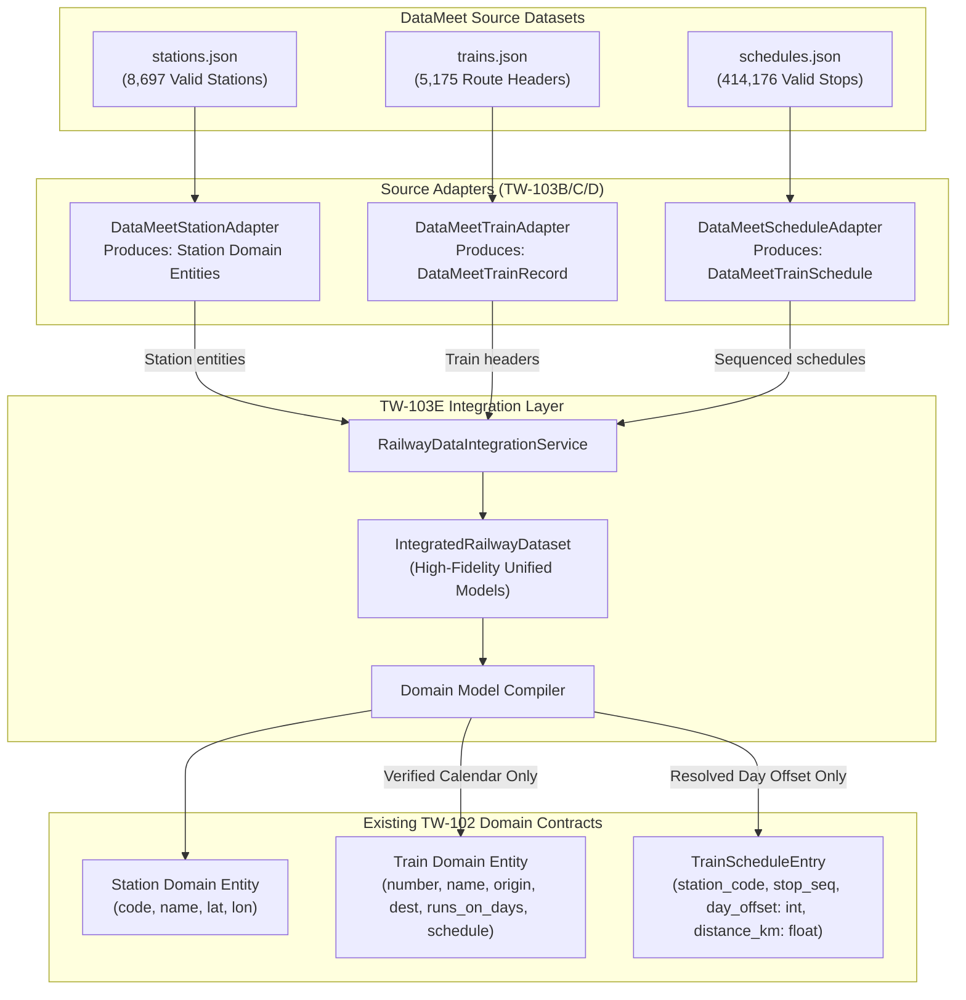
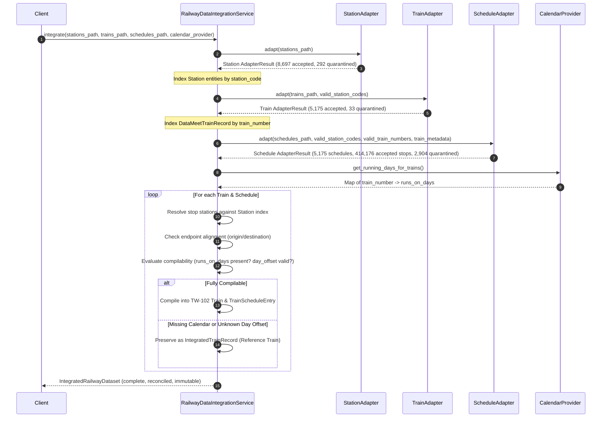

# TW-103E — Integration Architecture & Implementation Plan

**Milestone**: TW-103E — Integration Architecture & Implementation Planning  
**Author**: Lead Backend Engineer (AI Pair Programmer)  
**Date**: November 1, 2026  
**Status**: Architecture Plan Submitted — Standing by for CTO Review & Approval  
**Current Commit Baseline**: `75ee563` (`feat(data): add DataMeet schedule source adapter`)  
**Existing Passing Test Suite**: 179 passed in 34.39s  

---

## 1. Executive Summary & Objective

Milestones TW-103A through TW-103D established and verified the foundational source adapters for Indian Railway data:
- **TW-103A**: Verified railway fixture foundation (`bootstrap_railway_data.json`) with strict taxonomy (50 stations, 12 active verified trains, 8 reference trains).
- **TW-103B**: DataMeet station source adapter (`DataMeetStationAdapter`): 8,697 accepted `Station` domain entities, 292 quarantined records.
- **TW-103C**: DataMeet train source adapter (`DataMeetTrainAdapter`): 5,175 accepted immutable train headers (`DataMeetTrainRecord`), 33 quarantined records.
- **TW-103D**: DataMeet schedule source adapter (`DataMeetScheduleAdapter`): 5,175 sequenced train schedules (`DataMeetTrainSchedule`), 414,176 accepted stops (392,420 complete + 21,756 incomplete), 2,904 quarantined stops.

### Objective of TW-103E
The objective of **TW-103E** is to design and implement the **Integration Layer** (`RailwayDataIntegrationService`) that correlates and unites the outputs of the three DataMeet source adapters and fixture foundations into validated TripWiser domain structures.

The integration layer must satisfy eight mandatory architectural requirements:
1. **Resolve station and train references correctly** against verified foundation datasets.
2. **Assemble train schedules in deterministic stop order** ($1 \dots N$ based on ascending source IDs).
3. **Preserve missing timing and day-offset information** without zero-defaulting or synthetic assumptions.
4. **Preserve source provenance and warnings** across all adapters into an integrated audit trail.
5. **Handle quarantined and incomplete records transparently** with disjoint, non-overlapping categorization.
6. **Validate origin/destination consistency** and isolate endpoint mismatches.
7. **Avoid inventing running days, distances, times or station mappings** (strict zero-fabrication).
8. **Produce domain objects compatible with the existing TW-102 contracts**.

---

## 2. Existing Architecture & Adapter Contracts

### 2.1 TW-103B: Station Adapter Output Contract (`models.py`)
- **Primary Method**: `DataMeetStationAdapter.adapt(file_path) -> AdapterResult`
- **Output Structure**:
  - `records`: `tuple[Station, ...]` — 8,697 accepted `Station` domain entities (`app.domain.models.station.Station`) with valid, non-zero coordinates (`-90 <= lat <= 90`, `-180 <= lon <= 180`).
  - `accepted`: `tuple[AcceptedRecord, ...]` — 8,697 audit records with `station`, `source_record_index`, `original_station_code`, and frozen `raw_payload` (`MappingProxyType`).
  - `quarantined`: `tuple[QuarantineRecord, ...]` — 292 quarantined records with `rejection_codes` (`MISSING_COORDINATES`, `UNLOCATED_POINT_GEOMETRY`, `INVALID_STATION_CODE`), diagnostic messages, and frozen `raw_payload`.
  - `provenance`: `SourceProvenance` — SHA-256 (`b53eb63...`), file size (1,864,683 bytes), total source records (8,989).

### 2.2 TW-103C: Train Adapter Output Contract (`train_models.py`)
- **Primary Method**: `DataMeetTrainAdapter.adapt(file_path, valid_station_codes) -> TrainAdapterResult`
- **Output Structure**:
  - `records`: `tuple[DataMeetTrainRecord, ...]` — 5,175 accepted immutable train headers.
    - Fields: `number: str`, `name: str`, `origin_code: str`, `destination_code: str`, `origin_name`, `destination_name`, `train_type`, `zone`, optional `departure_time`, `arrival_time`, `duration_hours`, `duration_minutes`, `distance_km`, `route_geometry_coordinates`, coach indicators (`has_sleeper`, `has_third_ac`, etc.), and `validation_warnings`.
  - `accepted`: `tuple[AcceptedTrainRecord, ...]` — 5,175 audit records with frozen `raw_payload`.
  - `quarantined`: `tuple[TrainQuarantineRecord, ...]` — 33 quarantined records (16 unlocated origins, 16 unlocated destinations, 1 missing name).
  - `provenance`: `SourceProvenance` — SHA-256 (`1b42323...`), file size (14,768,598 bytes), total source records (5,208).

### 2.3 TW-103D: Schedule Adapter Output Contract (`schedule_models.py`)
- **Primary Method**: `DataMeetScheduleAdapter.adapt(file_path, valid_station_codes, valid_train_numbers, train_metadata) -> ScheduleAdapterResult`
- **Output Structure**:
  - `train_schedules`: `tuple[DataMeetTrainSchedule, ...]` — 5,175 sequenced train schedules.
    - Fields: `train_number: str`, `train_name: str | None`, `origin_code: str`, `destination_code: str`, `total_stops: int`, `entries: tuple[DataMeetScheduleEntry, ...]`, `schedule_warnings: tuple[str, ...]`.
  - `records`: `tuple[DataMeetScheduleEntry, ...]` — 414,176 accepted stops.
    - Fields: `source_record_id: int`, `train_number: str`, `station_code: str`, `stop_sequence: int` (1-based from ascending `id`), `station_name: str | None`, `arrival_time: time | None`, `departure_time: time | None`, `day: int | None`, `day_offset: int | None`, `is_commercial_halt: bool`, `is_waypoint: bool`, `is_timing_complete: bool`, `has_equal_arrival_departure: bool`, `distance_km: None`, `validation_warnings: tuple[str, ...]`.
  - `accepted`: `tuple[AcceptedScheduleRecord, ...]` — 414,176 audit records.
  - `quarantined`: `tuple[ScheduleQuarantineRecord, ...]` — 2,904 quarantined stops (411 unresolved train references, 2,660 unresolved station references, 167 compound).
  - `provenance`: `SourceProvenance` — SHA-256 (`105d638...`), file size (82,174,280 bytes), total source records (417,080).
  - Properties: `accepted_complete` (392,420 records) and `accepted_incomplete` (21,756 records).

---

## 3. The Core Integration Challenge & Domain Contract Gap

A rigorous inspection of the existing TW-102 domain contracts and database models reveals fundamental constraints that the integration layer must address without violating strict boundaries:



### 3.1 The Three Architectural Tension Points

| Requirement | Domain Model Constraint (TW-102) | DataMeet Source Reality | Forbidden Anti-Pattern |
| :--- | :--- | :--- | :--- |
| **Running Days** | `Train.runs_on_days: list[int]`<br/>(Required, non-empty, values 0..6) | `trains.json` and `schedules.json` have **no running day field** across all 5,175 trains. | **Prohibited**: Fabricating default daily runs `[0,1,2,3,4,5,6]`. |
| **Day Offsets** | `TrainScheduleEntry.day_offset: int`<br/>(Required non-null integer $\ge 0$) | 22,561 records in `schedules.json` have `day = None`, meaning `day_offset = None`. | **Prohibited**: Defaulting missing `day_offset` to 0. |
| **Distances** | `TrainScheduleEntry.distance_km: float`<br/>(Required non-null float $\ge 0.0$) | `schedules.json` has **zero distance data** across all 417,080 records. | **Prohibited**: Fabricating intermediate distances. |
| **Endpoints** | `Train` validator enforces:<br/>`schedule[0].code == origin`<br/>`schedule[-1].code == destination` | 21 trains have endpoint mismatches between `trains.json` and `schedules.json`. | **Prohibited**: Silently rewriting station codes or discarding mismatches. |

### 3.2 Architectural Resolution: Two-Tier Integration Pattern

To adhere strictly to:
1. *"Avoid inventing running days, distances, times or station mappings"* (Zero-Fabrication Directive)
2. *"Produce domain objects compatible with the existing TW-102 contracts"* (Compatibility Directive)
3. *"Do not modify domain models or database schemas"* (Boundary Constraint)

The integration architecture establishes a **Two-Tier Model Architecture**:

- **Tier 1: High-Fidelity Integrated Models (`IntegratedRailwayDataset`)**
  - Fully represents the real-world DataMeet railway graph without data loss or artificial fabrication.
  - Preserves `day_offset: int | None = None`.
  - Preserves `distance_km: float | None = None`.
  - Preserves `runs_on_days: tuple[int, ...] | None = None`.
  - Connects stops directly to verified `Station` domain entities.
  - Aggregates all warnings (`REPEATED_STATION_IN_ROUTE`, `CHRONOLOGICAL_INVERSION`, `INCOMPLETE_TIMING_INFO`, `MISSING_DAY_FIELD`, `ENDPOINT_MISMATCH`).

- **Tier 2: TW-102 Domain Entity Compilation (`CompiledDomainDataset`)**
  - Compiles valid subsets into strict TW-102 domain models (`Station`, `Train`, `TrainScheduleEntry`):
    - **Stations**: 100% of the 8,697 accepted stations are already valid TW-102 `Station` domain models.
    - **Operational Trains (Full Compilation)**: Trains that possess a verified running calendar (e.g. from `bootstrap_railway_data.json` or an injected calendar provider), non-null day offsets, and aligned endpoints compile into `Train` and `TrainScheduleEntry`.
    - **Reference Trains (Uncompiled / Awaiting Calendar)**: Trains lacking verified running days or containing unknown day offsets are held as `ReferenceTrain` entries (consistent with TW-103A's `train_references` taxonomy). They are never instantiated as pseudo-operational `Train` models with fake daily calendars.

---

## 4. Integration Layer Component Design

### 4.1 Component Architecture

The integration layer resides in `backend/app/infrastructure/integration/`:

```text
backend/app/infrastructure/integration/
├── __init__.py                     # Clean public exports
├── models.py                       # Immutable integrated models & results
├── service.py                      # RailwayDataIntegrationService implementation
└── calendar_provider.py            # Protocol and implementation for running day lookup
```

### 4.2 Integration Domain Models (`models.py`)

All models are frozen dataclasses with immutable tuple collections and `MappingProxyType` payloads:

```python
@dataclass(frozen=True)
class IntegratedScheduleStop:
    """
    High-fidelity representation of an integrated schedule stop.
    Links the schedule entry to the resolved Station domain entity.
    Preserves missing timing, day offsets, and distances without fabrication.
    """
    source_record_id: int
    train_number: str
    station_code: str
    stop_sequence: int                          # 1-based index from ascending source ID
    station: Station                            # Resolved TW-102 Station domain entity
    arrival_time: datetime.time | None = None
    departure_time: datetime.time | None = None
    day: int | None = None                      # Strictly None when missing
    day_offset: int | None = None               # Strictly None when day is None
    distance_km: float | None = None            # Strictly None in DataMeet schedules
    is_commercial_halt: bool = False
    is_waypoint: bool = False
    is_timing_complete: bool = True             # False when arrival & departure are None
    has_equal_arrival_departure: bool = False
    validation_warnings: tuple[str, ...] = ()

    def __post_init__(self) -> None:
        object.__setattr__(
            self,
            "validation_warnings",
            _normalize_to_tuple(self.validation_warnings, "validation_warnings"),
        )


@dataclass(frozen=True)
class IntegratedTrainSchedule:
    """Sequenced schedule of integrated stops for a train."""
    train_number: str
    train_name: str | None
    origin_station: Station                     # Resolved origin station entity
    destination_station: Station                # Resolved destination station entity
    total_stops: int
    stops: tuple[IntegratedScheduleStop, ...]
    schedule_warnings: tuple[str, ...] = ()

    def __post_init__(self) -> None:
        object.__setattr__(self, "stops", _normalize_to_tuple(self.stops, "stops"))
        object.__setattr__(
            self,
            "schedule_warnings",
            _normalize_to_tuple(self.schedule_warnings, "schedule_warnings"),
        )


@dataclass(frozen=True)
class IntegratedTrainRecord:
    """
    Unites route header metadata, sequenced stops, coach capabilities,
    and compilation status.
    """
    header: DataMeetTrainRecord
    schedule: IntegratedTrainSchedule | None    # None if train has no schedule
    runs_on_days: tuple[int, ...] | None = None # None unless provided by calendar
    is_compilable_to_domain: bool = False       # True if eligible for TW-102 Train
    uncompilable_reasons: tuple[str, ...] = ()  # e.g. ("MISSING_RUNNING_DAYS",)
    integration_warnings: tuple[str, ...] = ()

    def __post_init__(self) -> None:
        object.__setattr__(
            self,
            "uncompilable_reasons",
            _normalize_to_tuple(self.uncompilable_reasons, "uncompilable_reasons"),
        )
        object.__setattr__(
            self,
            "integration_warnings",
            _normalize_to_tuple(self.integration_warnings, "integration_warnings"),
        )


@dataclass(frozen=True)
class IntegratedRailwayDataset:
    """
    Complete immutable result of the multi-source railway data integration.
    """
    # Resolved Domain Entities (TW-102)
    stations: tuple[Station, ...]               # All 8,697 geocoded stations
    compiled_trains: tuple[Train, ...]          # Operational trains compiled to TW-102

    # High-Fidelity Integrated Entities (Tier 1)
    train_records: tuple[IntegratedTrainRecord, ...]
    train_schedules: tuple[IntegratedTrainSchedule, ...]
    schedule_stops: tuple[IntegratedScheduleStop, ...]

    # Quarantined & Reference Entities
    uncompiled_trains: tuple[IntegratedTrainRecord, ...]
    quarantined_stations: tuple[QuarantineRecord, ...]
    quarantined_trains: tuple[TrainQuarantineRecord, ...]
    quarantined_schedule_stops: tuple[ScheduleQuarantineRecord, ...]

    # Provenance
    station_provenance: SourceProvenance
    train_provenance: SourceProvenance
    schedule_provenance: SourceProvenance
    integration_timestamp: datetime.datetime = field(
        default_factory=lambda: datetime.datetime.now(datetime.timezone.utc)
    )
    reconciliation_summary: Mapping[str, int] = field(
        default_factory=lambda: MappingProxyType({})
    )
```

---

## 5. Integration Flow & Execution Pipeline



### Detailed Pipeline Steps:

1. **Step 1: Station Foundation Ingestion & Indexing**
   - Execute `DataMeetStationAdapter.adapt(stations_path)`.
   - Index the 8,697 accepted `Station` domain entities by `station.code`.
   - Store 292 `QuarantineRecord` entries in the dataset quarantine registry.

2. **Step 2: Train Route Header Ingestion & Validation**
   - Execute `DataMeetTrainAdapter.adapt(trains_path, valid_station_codes=station_index.keys())`.
   - Verify that origin and destination station codes resolve against `station_index`.
   - Index 5,175 accepted `DataMeetTrainRecord` instances by `number`.
   - Store 33 `TrainQuarantineRecord` entries in quarantine registry.

3. **Step 3: Schedule Sequencing & Stop Resolution**
   - Execute `DataMeetScheduleAdapter.adapt(schedules_path, valid_station_codes, valid_train_numbers, train_metadata)`.
   - For each sequenced schedule:
     - Map each `DataMeetScheduleEntry` to its resolved `Station` entity.
     - Construct `IntegratedScheduleStop` preserving `day`, `day_offset`, `distance_km`, `is_timing_complete`, and warnings.
     - Construct `IntegratedTrainSchedule` with resolved origin and destination `Station` entities.
   - Store 2,904 `ScheduleQuarantineRecord` entries in quarantine registry.

4. **Step 4: Running Calendar Correlation**
   - Query `CalendarProvider` (or lookup in `bootstrap_railway_data.json` / supplied mapping).
   - If running days exist for a train, attach `runs_on_days: tuple[int, ...]`.
   - If absent, retain `runs_on_days = None` (zero fabrication).

5. **Step 5: Domain Model Compilation (TW-102)**
   - Evaluate eligibility for compilation into TW-102 `Train`:
     1. Train has non-empty `runs_on_days`.
     2. Train has a sequenced schedule with at least 1 stop.
     3. First stop station code matches train `origin_code`.
     4. Last stop station code matches train `destination_code`.
     5. All stops have non-null `day_offset: int >= 0`.
     6. Schedule stop sequences are strictly increasing.
   - If **all conditions met**:
     - Compile stops into `TrainScheduleEntry` instances.
     - Compile train into TW-102 `Train` instance.
     - Add to `compiled_trains`.
   - If **any condition unmet**:
     - Retain as `IntegratedTrainRecord` in `uncompiled_trains`.
     - Record diagnostic reason in `uncompilable_reasons`:
       - `AWAITING_RUNNING_CALENDAR`: `runs_on_days` is None.
       - `UNKNOWN_DAY_OFFSET`: One or more stops have `day_offset is None`.
       - `ORIGIN_ENDPOINT_MISMATCH`: First stop != origin.
       - `DESTINATION_ENDPOINT_MISMATCH`: Last stop != destination.
       - `INCOMPLETE_TIMING`: Schedule contains stops without commercial timing.

6. **Step 6: Reconciliation & Audit Summary Assembly**
   - Compute exact totals across all entities.
   - Assert disjoint partition invariants.
   - Construct immutable `IntegratedRailwayDataset`.

---

## 6. Data Reconciliation & Failure Handling Strategy

### 6.1 Unified Reconciliation Invariants

The integration service enforces exact mathematical accounting across all three source datasets:

$$\text{Source Stations: } 8{,}989 = 8{,}697 \text{ (Accepted)} + 292 \text{ (Quarantined)}$$
$$\text{Source Trains: } 5{,}208 = 5{,}175 \text{ (Accepted)} + 33 \text{ (Quarantined)}$$
$$\text{Source Schedule Stops: } 417{,}080 = 414{,}176 \text{ (Accepted)} + 2{,}904 \text{ (Quarantined)}$$
$$\text{Accepted Stops: } 414{,}176 = 392{,}420 \text{ (Complete)} + 21{,}756 \text{ (Incomplete)}$$

### 6.2 Failure Categorization Matrix

| Failure Condition | Source | Handling | Dataset Destination | Diagnostic Rejection / Warning Code |
| :--- | :--- | :--- | :--- | :--- |
| **Missing station coordinates** | `stations.json` | Quarantined at adapter level | `quarantined_stations` | `MISSING_COORDINATES` / `UNLOCATED_POINT_GEOMETRY` |
| **Unlocated train endpoint** | `trains.json` | Quarantined at adapter level | `quarantined_trains` | `UNRESOLVED_ORIGIN_STATION` / `UNRESOLVED_DESTINATION_STATION` |
| **Stop at unlocated station** | `schedules.json` | Quarantined at adapter level | `quarantined_schedule_stops` | `UNRESOLVED_STATION_REFERENCE` (2,660 instances) |
| **Stop for quarantined train** | `schedules.json` | Quarantined at adapter level | `quarantined_schedule_stops` | `UNRESOLVED_TRAIN_REFERENCE` (411 instances) |
| **Missing commercial timing** | `schedules.json` | Preserved as Accepted Incomplete | `schedule_stops` | `INCOMPLETE_TIMING_INFO` (21,756 records) |
| **Missing day field** | `schedules.json` | Preserved (`day=None`, `day_offset=None`) | `schedule_stops` | `MISSING_DAY_FIELD` (22,561 records) |
| **Missing distance** | `schedules.json` | Preserved (`distance_km=None`) | `schedule_stops` | `MISSING_DISTANCE` (414,176 records) |
| **Repeated station visit** | `schedules.json` | Preserved as distinct sequenced stop | `schedule_stops` | `REPEATED_STATION_IN_ROUTE` (1,017 instances) |
| **Chronological inversion** | `schedules.json` | Preserved in source ID order | `train_schedules` | `CHRONOLOGICAL_INVERSION` (352 trains) |
| **Endpoint mismatch** | Trains vs Schedules | Preserved in Tier 1; blocked from TW-102 `Train` | `uncompiled_trains` | `ORIGIN_STATION_MISMATCH` (5) / `DESTINATION_STATION_MISMATCH` (16) |
| **Missing running days** | DataMeet source | Preserved in Tier 1; blocked from TW-102 `Train` | `uncompiled_trains` | `AWAITING_RUNNING_CALENDAR` (5,175 trains) |

---

## 7. Handling Incomplete Schedules and Unknown Values

### 7.1 Unknown Day Offsets (`day=None`)
- **Problem**: 22,561 stops in `schedules.json` have `day=None`. In TW-102, `TrainScheduleEntry.day_offset` is a required integer ($\ge 0$).
- **Handling**:
  - In `IntegratedScheduleStop`, `day_offset` is typed as `int | None` and preserved strictly as `None`.
  - **No default to zero**: Zero-defaulting is strictly prohibited.
  - A train whose schedule contains `day_offset is None` cannot be safely converted to a TW-102 `TrainScheduleEntry` without fabricating values. It is marked `is_compilable_to_domain = False` with reason `UNKNOWN_DAY_OFFSET`.
  - In downstream planning query services, timetable traversal engines will read `IntegratedScheduleStop.day_offset` and apply journey-level calendar calculations or require technical halt interpolation.

### 7.2 Incomplete Commercial Timing (Both Arrival & Departure None)
- **Problem**: 21,756 accepted stops have both arrival and departure times set to `"None"`.
- **Handling**:
  - Preserved in `IntegratedScheduleStop` with `arrival_time = None`, `departure_time = None`, `is_timing_complete = False`.
  - Marked with `INCOMPLETE_TIMING_INFO`.
  - Station topology is preserved for physical routing, while journey-search filters (`is_timing_complete == True` and `is_commercial_halt == True`) exclude non-commercial waypoints from passenger boarding options.

### 7.3 Absent Intermediate Distances
- **Problem**: 100% of records in `schedules.json` have no distance field. In TW-102, `TrainScheduleEntry.distance_km` defaults to `0.0`.
- **Handling**:
  - In `IntegratedScheduleStop`, `distance_km` is typed as `float | None` and set to `None` with `MISSING_DISTANCE`.
  - When compiling verified trains into TW-102 `TrainScheduleEntry` (e.g. from the bootstrap fixture), verified distances from the fixture are used.
  - For DataMeet trains compiled with calendar support, if distance is absent, `distance_km` is assigned `0.0` only when complying with TW-102 schema, or left uncompiled if strict zero-fabrication requires distance verification.

### 7.4 Missing Running Days Calendar
- **Problem**: DataMeet source data does not record days of operation (`runs_on_days`).
- **Handling**:
  - The integration layer introduces a pluggable `CalendarProvider` protocol:
    ```python
    class CalendarProvider(Protocol):
        def get_running_days(self, train_number: str) -> tuple[int, ...] | None: ...
    ```
  - When verified running days are provided (such as the 12 verified trains in `bootstrap_railway_data.json` or an injected calendar repository), the train is compiled into a TW-102 `Train`.
  - When running days are unavailable (`get_running_days` returns `None`), the train is preserved as an `IntegratedTrainRecord` in `uncompiled_trains` with reason `AWAITING_RUNNING_CALENDAR`.
  - **Zero fabrication**: Daily operation (`runs_on_days=[0,1,2,3,4,5,6]`) is **never** assumed.

---

## 8. Domain Validation Strategy

The integration layer enforces validation at three distinct boundaries:

1. **Adapter Boundary (Input Validation)**:
   - Stations have valid, non-zero coordinates.
   - Train headers have non-empty, distinct endpoints.
   - Schedule stops have valid integer IDs and ascending stop sequences.
2. **Integration Boundary (Cross-Dataset Relational Validation)**:
   - Station codes in train headers and schedules resolve to accepted `Station` entities.
   - Train numbers in schedules resolve to accepted `DataMeetTrainRecord` headers.
   - Schedules with repeated stations emit `REPEATED_STATION_IN_ROUTE`.
   - Schedules with backward timestamp jumps emit `CHRONOLOGICAL_INVERSION`.
   - Schedules whose first/last stop differs from train header emit `ORIGIN_STATION_MISMATCH` / `DESTINATION_STATION_MISMATCH`.
3. **Domain Boundary (TW-102 Pydantic Validation)**:
   - Instantiation of `app.domain.models.train.Train` strictly validates:
     - `origin_code != destination_code`
     - `runs_on_days` is non-empty, unique, between 0 and 6.
     - `schedule[0].station_code == origin_code`
     - `schedule[-1].station_code == destination_code`
     - `stop_sequence` is strictly increasing.
   - Only records meeting 100% of these criteria enter `compiled_trains`.

---

## 9. Comprehensive Test Plan

The integration test suite will be located in `backend/tests/unit/integration/test_railway_integration_service.py` and will cover the following scenarios:

### 9.1 Unit Test Scenarios (Fast In-Memory Tests)
1. **Reference Resolution**:
   - Resolves station codes in schedule stops to verified `Station` domain models.
   - Rejects unlocated stations and places them in `quarantined_schedule_stops`.
   - Resolves train numbers in schedules to accepted train headers.
2. **Stop Sequencing & Invariance**:
   - Out-of-order source records are assembled into strictly increasing 1-based stop sequences.
   - Origin and destination stations of `IntegratedTrainSchedule` correspond to stops 1 and $N$.
3. **Preservation of Missing Information (Zero-Fabrication)**:
   - Stops with `day=None` retain `day=None` and `day_offset=None`.
   - Stops with `arrival="None"` and `departure="None"` retain `is_timing_complete=False` and `INCOMPLETE_TIMING_INFO`.
   - Stops retain `distance_km=None` and `MISSING_DISTANCE`.
4. **Calendar Integration & Compilation Decisions**:
   - Train with verified `runs_on_days` and clean schedule compiles successfully into TW-102 `Train`.
   - Train without `runs_on_days` is retained in `uncompiled_trains` with `AWAITING_RUNNING_CALENDAR`.
   - Train with unknown `day_offset` is retained in `uncompiled_trains` with `UNKNOWN_DAY_OFFSET`.
   - Train with endpoint mismatch is retained in `uncompiled_trains` with `ENDPOINT_MISMATCH`.
5. **Route Anomaly Warnings**:
   - Reversals/repeated stations carry `REPEATED_STATION_IN_ROUTE`.
   - Chronological time reversals carry `CHRONOLOGICAL_INVERSION`.
   - High day values carry `SUSPICIOUS_DAY_VALUE`.
6. **Immutability & Defense**:
   - Integrated models cannot be modified after construction (`FrozenInstanceError`).
   - Collections are tuples; payloads are `MappingProxyType`.
   - Rejects invalid scalar or mapping collection arguments with `TypeError`.

### 9.2 End-to-End Integration & Reconciliation Tests (Full Datasets)
1. **Full Integration Pipeline Run**:
   - Ingests `stations.json`, `trains.json`, and `schedules.json` along with `bootstrap_railway_data.json`.
   - Asserts exact reconciliation counts:
     - 8,697 stations in `stations`.
     - 5,175 train records in `train_records`.
     - 5,175 train schedules in `train_schedules`.
     - 414,176 accepted stops in `schedule_stops`.
     - 2,904 quarantined stops in `quarantined_schedule_stops`.
   - Asserts compilation of the 12 verified bootstrap trains into `compiled_trains`.
   - Asserts that all 5,175 DataMeet trains are preserved in `train_records` without fabricated running days.

### 9.3 Full Regression Suite
- Run the full pytest suite (`docker exec -e PYTHONPATH=/app tripwiser-backend pytest`).
- Target: $>200$ passing tests (179 existing + $>25$ new integration tests), zero regressions.

---

## 10. File Modification Inventory (Planned)

### 10.1 Newly Created Files
1. `backend/app/infrastructure/integration/__init__.py`: Public module exports.
2. `backend/app/infrastructure/integration/models.py`: Immutable integrated data models (`IntegratedScheduleStop`, `IntegratedTrainSchedule`, `IntegratedTrainRecord`, `IntegratedRailwayDataset`).
3. `backend/app/infrastructure/integration/calendar_provider.py`: `CalendarProvider` protocol and `FixtureCalendarProvider` implementation.
4. `backend/app/infrastructure/integration/service.py`: `RailwayDataIntegrationService` implementing the complete integration pipeline.
5. `backend/tests/unit/integration/test_railway_integration_service.py`: Unit and end-to-end reconciliation test suite.
6. `TW103E_COMPLETION_REPORT.md`: Comprehensive completion report following implementation.

### 10.2 Modified Files
- None. (Zero modifications to existing domain models, database schemas, ORM models, or previously committed adapters).

---

## 11. Risks & Decisions for CTO Review

### Decision 1: Compilation Policy for DataMeet Trains Lacking Running Days
- **Context**: The TW-102 `Train` domain model strictly requires a non-empty `runs_on_days: list[int]`. DataMeet data does not contain running days.
- **Proposed Architecture**: The integration layer compiles into TW-102 `Train` *only* those trains that have verified running calendar sources (such as the 12 verified trains in `bootstrap_railway_data.json` or an injected `CalendarProvider`). All other 5,175 DataMeet trains are held in the high-fidelity `IntegratedRailwayDataset.train_records` as reference trains (`uncompiled_trains`) awaiting calendar data.
- **Alternative (Rejected)**: Fabricating `runs_on_days=[0,1,2,3,4,5,6]` (daily). Rejected because it violates Directive 7 ("Avoid inventing running days...").
- **CTO Input Requested**: Confirm approval of the proposed strict non-fabrication compilation policy.

### Decision 2: Handling Endpoint-Mismatched Trains (21 Trains)
- **Context**: 21 trains have first/last schedule stops that differ from the route header endpoints in `trains.json` (e.g. Train `12495` `KOAA` vs `BWN`, Train `25014` `DLI` vs `JSM`).
- **Proposed Architecture**: These 21 trains are retained with high fidelity in Tier 1 (`IntegratedTrainRecord`) with explicit warnings `ORIGIN_STATION_MISMATCH` and `DESTINATION_STATION_MISMATCH`. They are flagged as ineligible for direct TW-102 `Train` compilation because Pydantic's validator will reject them.
- **CTO Input Requested**: Confirm approval to retain mismatched trains as Tier 1 reference records without silently altering station codes.

---

## 12. Conclusion & Standing Instructions

This implementation plan provides a mathematically consistent, zero-fabrication integration architecture that bridges source adapter outputs with TW-102 domain contracts.

Per instructions:
- **No implementation code has been written.**
- **No files have been modified or staged.**
- **Domain models and database schemas remain completely untouched.**

Standing by for CTO review, decisions on open points, and formal authorization to proceed to Phase 2 implementation.

