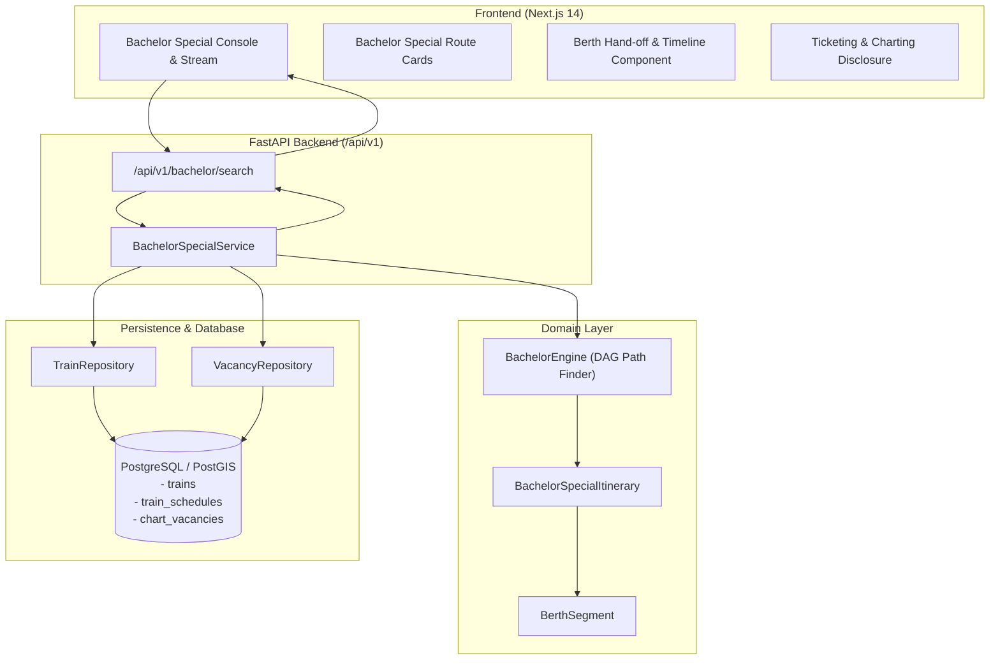

# TW-107 Implementation Plan: Bachelor Special — Berth Segment Discovery

**Milestone**: TW-107  
**Feature**: Bachelor Special (Signature Berth Segment Discovery)  
**Status**: IN PROGRESS / APPROVED FOR IMPLEMENTATION  
**Authors**: Antigravity Pair Programming Engine  
**Date**: November 2026  

---

## 1. Executive Summary & Objective

**Bachelor Special** is TripWiser's signature feature designed to solve a ubiquitous Indian Railways pain point: when a through ticket between origin and destination is on waitlist or unavailable on a popular train, vacant berths frequently exist over intermediate legs (e.g. Passenger A deboards at an intermediate station while Passenger B boards later). 

By identifying and assembling multiple vacant berth segments on the **same train and journey date**, Bachelor Special provides passengers with continuous station coverage from origin to destination without changing trains, clearly detailing where and when berth relocations occur.

### Core Principles
1. **Same Train, Same Date**: All combined segments must strictly belong to the same train run.
2. **Gapless Station-Sequence Continuity**: From boarding station sequence to destination sequence, every segment's destination station and sequence must exactly match the succeeding segment's origin station and sequence ($e_i.\text{to\_seq} == e_{i+1}.\text{from\_seq}$).
3. **Zero Fabrication**: Vacancies are never synthetically generated or presented as live railway availability unless queried from verified chart records in `chart_vacancies`.
4. **Transparent Regulatory & Ticketing Disclosure**: The system clearly communicates that combined itineraries do not guarantee a single ticket or PNR, and requires separate booking or TTE endorsement.

---

## 2. Architecture & Components

---

## 3. Algorithm: Continuous Berth Segment Discovery

Given:
- Origin Station $S_{origin}$ with stop sequence $seq_{origin}$.
- Destination Station $S_{dest}$ with stop sequence $seq_{dest}$ ($seq_{origin} < seq_{dest}$).
- Travel Date $D$, Travel Class $C$.
- Candidate direct trains operating between $S_{origin}$ and $S_{dest}$ on date $D$.

For each operating train:
1. Retrieve schedule stops between $seq_{origin}$ and $seq_{dest}$.
2. Query `chart_vacancies` for unexpired, active records where:
   - `train_number = train.number`
   - `chart_date = D`
   - `status = 'VACANT'`
   - `from_sequence >= seq_{origin}`
   - `to_sequence <= seq_{dest}`
   - `travel_class = C` (if specified)
3. Construct a Directed Acyclic Graph (DAG) where:
   - Nodes: Stop sequences $s \in [seq_{origin}, seq_{dest}]$.
   - Edges: Available berth segments $(u, v)$ where $u = \text{from\_sequence}$ and $v = \text{to\_sequence}$.
4. Find paths from $seq_{origin}$ to $seq_{dest}$:
   - Enforce path continuity: $e_i.\text{to\_seq} == e_{i+1}.\text{from\_seq}$ and $e_i.\text{to\_station} == e_{i+1}.\text{from\_station}$.
   - Depth-bounding: Restrict to max 4 segments ($\le 3$ berth changes) for practical passenger convenience.
   - Disallow conflicting overlaps (no simultaneous berth allocations).
5. Assemble and validate each path using the strict `BachelorSpecialItinerary` Pydantic model.
6. Rank discovered itineraries:
   - Fewest berth changes first (minimize disruption).
   - Same-coach continuity preferred (moving within coach B2 vs moving coaches).
   - Lower berth preference tie-breaker.

---

## 4. Key Implementation Steps

### Step 1: Vacancy Repository Layer
- Create `backend/app/domain/repositories/vacancy_repository.py`:
  - Abstract interface `VacancyRepository`.
- Create `backend/app/infrastructure/database/repositories/vacancy_repository.py`:
  - `PostgresVacancyRepository`: query `chart_vacancies`, mapping `ChartVacancyORM` $\to$ `BerthSegment`.

### Step 2: Bachelor Engine & Discovery Service
- Create `backend/app/domain/services/bachelor_engine.py`:
  - Pure algorithm for DAG segment path search and itinerary construction.
- Create `backend/app/domain/services/bachelor_service.py`:
  - Orchestration service querying train schedules and vacancies, invoking the engine, handling stale/empty states honestly.

### Step 3: API Endpoint
- Create `backend/app/api/v1/bachelor.py`:
  - `GET /api/v1/bachelor/search`:
    - `origin`: Boarding station code.
    - `destination`: Alighting station code.
    - `date`: Travel date.
    - `travel_class`: Optional class filter (e.g. `3A`, `2A`, `SL`).
- Register router in `backend/app/main.py`.

### Step 4: Frontend Dedicated Experience
- Add Bachelor Special mode toggle / dedicated tab in the Next.js header and search view.
- Create `frontend/src/components/bachelor/BachelorSpecialConsole.tsx`:
  - Signature badge ("TripWiser Signature — Same Train, Continuous Berths").
  - Origin, destination, date inputs (reusing existing autocomplete).
- Create `frontend/src/components/bachelor/BachelorSpecialCard.tsx`:
  - Visual segment breakdown showing coach, berth number, berth type (UB, MB, LB, SL, SU).
  - Explicit Berth Change indicator between consecutive legs.
  - Zero-Fabrication disclosure banner explaining Indian Railways charting rules (first chart $\approx 4\text{h}$ prior to train origin departure).

### Step 5: Verification & Testing
- Unit tests: DAG path matching, gaps, overlaps, multi-segment combinations, depth bounding.
- Integration tests: Database persistence, vacancy queries with expiry filters, API response contracts.
- Frontend build: `npm run build` static generation (0 errors).
- Browser E2E: Automated browser test querying Bachelor Special, opening details, checking disclosures, verifying mobile layout.
- Full regression: Execute all 211 existing backend tests.

