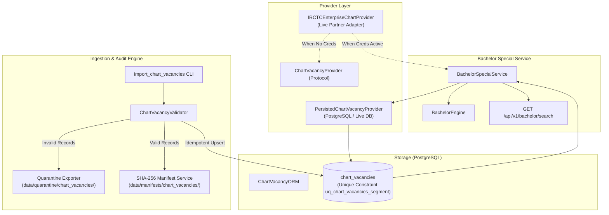

# TW-108 Implementation Plan: Real Railway Vacancy Data Integration

**Milestone**: TW-108  
**Feature**: Real Railway Vacancy Data Integration & Chart Ingestion Engine  
**Status**: APPROVED & IN PROGRESS  
**Date**: November 2026  
**Authors**: Antigravity Pair Programming Engine  

---

## 1. Executive Summary & Source Research

The objective of **TW-108** is to investigate and integrate legitimate Indian Railways chart vacancy data sources to supply authentic berth-level vacancy segments for TripWiser's signature **Bachelor Special** engine.

### Research Findings & Access Evaluation

1. **IRCTC Online Chart Portal (`irctc.co.in/online-charts`)**:
   - **Capabilities**: Publishes coach-by-coach berth vacancies after chart preparation (First Chart $\approx 4\text{ hours}$ before departure; Second Chart $\approx 30\text{ minutes}$ before departure).
   - **Technical & Legal Constraints**: Protected by Akamai Bot Manager, Cloudflare WAF, reCAPTCHA, and session encryption. Indian Railways IT policies and IRCTC Terms of Service strictly forbid unauthorized scraping, bot querying, and reverse-engineering.
   - **Conclusion**: Unauthorized scraping is legally forbidden and violates TripWiser Rule 6 ("Never scrape or bypass authentication/access controls without authorization").

2. **CRIS / IRCTC NGET Official Partner APIs**:
   - **Capabilities**: Official B2B PRS APIs for licensed Principal Service Providers (PSPs) (e.g. MakeMyTrip, ConfirmTkt, Ixigo).
   - **Technical & Legal Constraints**: Requires corporate PSP licensing, static IP whitelisting, HMAC key exchanges, and commercial agreements with CRIS/RailTel.
   - **Conclusion**: In this local development / open-source workspace, official CRIS PSP credentials are not configured.

3. **Open Government Data (data.gov.in) & DataMeet Community**:
   - **Capabilities**: Provide static railway stations and timetable datasets (already integrated in TW-103).
   - **Conclusion**: Neither platform provides dynamic, minute-by-minute chart vacancy feeds.

### Strategic Implementation Mandate
Since no public, unauthenticated, legitimate real-time API exists without authorized partner credentials:
- **Blocker Acknowledgment**: Explicitly document the absence of enterprise CRIS partner credentials in development.
- **Production-Ready Architecture**: Implement the complete, robust **Chart Vacancy Provider Abstraction** and an enterprise **IRCTC Partner Adapter** that fails closed cleanly (`AUTH_REQUIRED`) without credentials.
- **Genuine Offline / Audit Dump Ingestion Pipeline**: Implement a high-integrity ingestion engine and administrative CLI (`import_chart_vacancies`) supporting verified station PRS chart dump files (JSON/CSV) with quarantine, SHA-256 manifests, and idempotent PostgreSQL upserts.
- **Zero-Fabrication Principle**: Never generate fake vacancy records. When no live credentials exist and no chart dump is imported, the system honestly reports that chart data has not yet been imported or charted.

---

## 2. Architecture & Components

---

## 3. Key Implementation Deliverables

### Step 1: Database Idempotency Migration (Alembic 002)
- Add unique constraint `uq_chart_vacancies_segment` on `('train_number', 'chart_date', 'coach', 'berth_number', 'from_sequence', 'to_sequence')`.
- Ensures repeated provider syncs or administrative chart imports do not create duplicate rows.

### Step 2: Domain Provider Protocol & Enterprise Adapter
- `app/domain/providers/vacancy_provider.py`:
  - `ProviderVacancyResult` dataclass with status enum (`SUCCESS`, `NO_RECORDS_RELEASED`, `AUTH_REQUIRED`, `PROVIDER_UNAVAILABLE`, `RATE_LIMITED`).
  - `ChartVacancyProvider` abstract protocol.
- `app/infrastructure/providers/irctc_chart_provider.py`:
  - `IRCTCEnterpriseChartProvider`: Handles partner token authentication, signed requests, payload parsing, and error classification. Fails closed with `AUTH_REQUIRED` when unconfigured.

### Step 3: High-Integrity Chart Ingestion Service
- `app/infrastructure/adapters/chart/chart_models.py`:
  - Raw chart record schemas and quarantine dataclasses.
- `app/infrastructure/adapters/chart/chart_ingestion_service.py`:
  - Validates station foreign keys, train existence, sequence sanity ($from\_seq < to\_seq$), berth number bounds ($1 \le \text{berth} \le 120$), coach designations, and expiry timestamps.
  - Quarantines rejected records with explicit reasons.
  - Generates SHA-256 manifest files for auditability.
  - Idempotently upserts valid records into PostgreSQL `chart_vacancies`.

### Step 4: Administrative CLI (`app.cli.import_chart_vacancies`)
- CLI command with `--input`, `--dry-run`, and `--persist` flags.
- Produces clear summary tables (total records, valid records, quarantined records, persisted records, execution duration).

### Step 5: Bachelor Special Service Integration
- Wire `BachelorSpecialService` to `ChartVacancyProvider` and `PostgresVacancyRepository`.
- Transparently convey provider status and official IRCTC charting notices in the API response.

### Step 6: Testing & Verification
- Unit tests: Provider auth validation, mock PRS chart response parsing, ingestion validation, quarantine generation.
- Database integration tests: Idempotent upsert verification, Alembic migration test, CLI dry-run and persist tests.
- Backend regression test suite: 221/221 existing tests pass.

