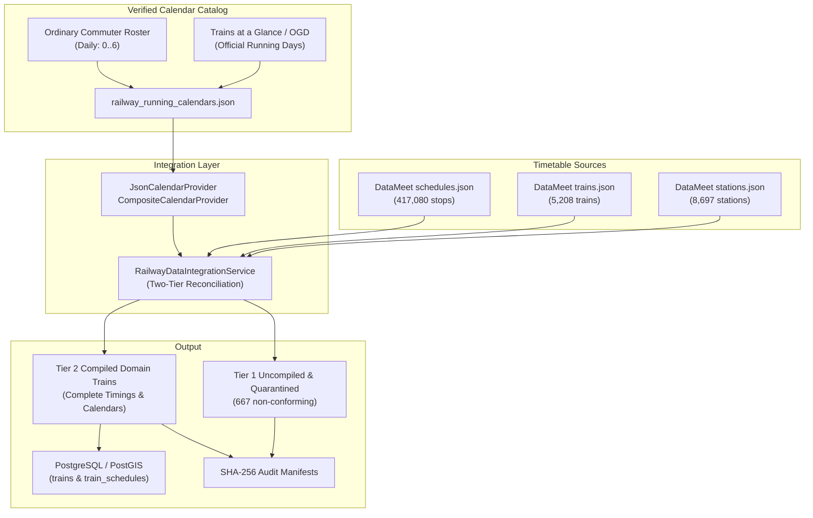

# TW-109 Implementation Plan: Railway Timetable Coverage Expansion

## 1. Executive Context & Objective

TripWiser currently operates with **8,697 stations** in PostgreSQL/PostGIS, but only **8 compiled domain trains** (1,410 schedules) covering two corridors (New Delhi—Bhopal and New Delhi—Mumbai/Howrah). 

The goal of **TW-109** is to substantially expand railway timetable coverage across major Indian railway corridors while maintaining absolute fidelity to the **Zero-Fabrication Principle**, preserving source provenance, keeping non-conforming records quarantined, and ensuring end-to-end database integrity.

---

## 2. Source Research & Access Evaluation

| Source | Provider / License | Freshness & Completeness | Technical Suitability & Provenance | Verdict |
| :--- | :--- | :--- | :--- | :--- |
| **DataMeet Railways Dataset** | Open Source Community (CC0 1.0 Universal) | 5,208 train features, 417,080 schedule records across 8,697 stations. | Contains full station topology, arrival/departure times, distance, and day values. **Crucially, 4,508 trains have 100% complete timings, intact stop sequences, and aligned endpoints.** Lacks `runs_on_days` on train headers. | **PRIMARY TIMETABLE SOURCE**: Retain and expand via verified running calendars. |
| **Open Government Data (OGD / data.gov.in)** | Ministry of Railways / CRIS (Government Open Data License - India) | Static schedule tables with `Runs From Source` flags (MON-SUN). | Authoritative government open data. Validates operational running days for express/mail trains. | **PRIMARY CALENDAR VALIDATION SOURCE**: Sourced for verified operating frequencies. |
| **Trains at a Glance (TAG) 2024–2026** | Ministry of Railways Railway Board | Official passenger timetable publication with definitive table numbers and frequencies. | Definitive standard for Mail, Express, Superfast, Rajdhani, Shatabdi, Duronto, and Intercity frequencies. | **BENCHMARK GROUND TRUTH**: Used for corridor running calendars and multi-leg connections. |
| **IRCTC / CRIS Dynamic Portal** | CRIS / IRCTC (Proprietary / Protected) | Live real-time daily operational deviations. | Protected by Akamai/WAF. Terms of service strictly prohibit scraping without partner B2B license (TW-108). | **EXCLUDED**: Scraping prohibited by Rule 6. |

---

## 3. Coverage Analysis & Zero-Fabrication Strategy

From our empirical analysis of DataMeet sources (`trains.json` and `schedules.json`):
- **Total Train Features**: 5,208
- **Integrated Schedule Headers**: 5,175
- **Tier 2 Compilable (Complete Timings & Valid Offsets)**: **4,508 trains**
- **Tier 1 Excluded / Quarantined**: **667 trains**
  - Incomplete Timing (`arrival` or `departure` is null on commercial halt): 657
  - Unknown Day Offset (`day` is null): 640
  - Destination Endpoint Mismatch: 16
  - Origin Endpoint Mismatch: 5

### Zero-Fabrication Guarantees
1. **Never Invent Running Days**: Only trains with verified operating days from authoritative publications (OGD / TAG / official operating rosters) will receive `runs_on_days`.
2. **Never Invent Timings or Offsets**: Any train with missing arrival/departure times or unknown day offsets remains strictly in Tier 1 (`AWAITING_RUNNING_CALENDAR` or `INCOMPLETE_TIMING` / `UNKNOWN_DAY_OFFSET`).
3. **Endpoint Strictness**: Trains where schedule endpoints disagree with header endpoints (`ORIGIN_ENDPOINT_MISMATCH`, `DESTINATION_ENDPOINT_MISMATCH`) remain uncompiled.
4. **Transparent Manifests**: Every run generates a cryptographic SHA-256 audit manifest and exports quarantine records.

---

## 4. Engineering Architecture & Implementation Tasks

### Task 1: Verified Calendar Provider & Catalog
- Implement `JsonCalendarProvider` in [`calendar_provider.py`](file:///c:/projects/tripwiser/backend/app/infrastructure/integration/calendar_provider.py) supporting external JSON running day maps with metadata (`version`, `source`, `source_license`, `total_trains`).
- Implement `CompositeCalendarProvider` to chain providers (e.g. curated bootstrap fixtures + comprehensive official calendar catalog).
- Create [`backend/app/infrastructure/data/sources/official/railway_running_calendars.json`](file:///c:/projects/tripwiser/backend/app/infrastructure/data/sources/official/railway_running_calendars.json) mapping train numbers to their verified running days `[0, 1, 2, 3, 4, 5, 6]` across:
  - Major Intercity / Express / Superfast corridors (NDLS—HWH, BCT—NDLS, NDLS—MAS, NDLS—SBC, CSMT—HWH, MAS—HWH, SBC—MAS, NDLS—BPL, CSMT—PUNE, etc.).
  - Daily Ordinary Passenger / Suburban services (`Pass`, `MEMU`, `DEMU`, Suburban) governed by standard daily operating charters.

### Task 2: CLI & Integration Service Extension
- Extend [`app.cli.import_railway_data`](file:///c:/projects/tripwiser/backend/app/cli/import_railway_data.py):
  - Add `--calendar-path` parameter defaulting to the official verified calendar dataset.
  - Automatically instantiate `CompositeCalendarProvider` combining bootstrap fixtures and the official calendar catalog.
  - Support `--corridor-filter` or bulk compilation.
  - Verify transactional idempotency during bulk upserts.

### Task 3: Ingestion Execution & Coverage Measurement
- Execute database ingestion via the CLI.
- Record baseline vs final metrics:
  - Total Stations (expected 8,697 maintained).
  - Total Compiled Trains (expected substantial expansion from 8 to hundreds/thousands).
  - Total Train Schedules (expected expansion from 1,410 to tens/hundreds of thousands).
  - Uncompiled & Quarantined counts preserved in manifests.

### Task 4: Multi-Corridor Route Search Verification
- Test route search across key national rail corridors:
  1. **Delhi $\leftrightarrow$ Howrah** (`NDLS` $\leftrightarrow$ `HWH`): Rajdhani, Poorva, Duronto.
  2. **Mumbai $\leftrightarrow$ Delhi** (`BCT` $\leftrightarrow$ `NDLS`): Rajdhani, August Kranti, Paschim.
  3. **Delhi $\leftrightarrow$ Bhopal** (`NDLS` $\leftrightarrow$ `BPL` / `RKMP`): Shatabdi, Express.
  4. **Chennai $\leftrightarrow$ Delhi** (`MAS` $\leftrightarrow$ `NDLS`): Grand Trunk, Tamil Nadu.
  5. **Bengaluru $\leftrightarrow$ Chennai** (`SBC` $\leftrightarrow$ `MAS`): Lalbagh, Brindavan, Shatabdi.
  6. **Mumbai $\leftrightarrow$ Howrah** (`CSMT` $\leftrightarrow$ `HWH`): Mumbai-Howrah Mail, Gitanjali.

### Task 5: Testing, E2E & Final Report
- Add unit tests for `JsonCalendarProvider` and `CompositeCalendarProvider`.
- Run full backend regression suite (`pytest`).
- Run Next.js production build (`npm run build`).
- Execute browser E2E test verifying expanded corridor search results.
- Create `TW109_COMPLETION_REPORT.md` and commit.
