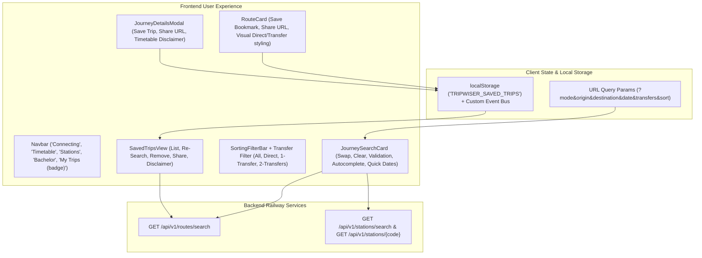

# TW-114 Implementation Plan — Passenger Journey Experience & Search Refinement

## 1. Objectives & Scope
Improve the passenger journey experience on TripWiser without rebuilding working systems:
- **Search Experience**: Smoother origin/destination selection, clean station autocomplete (code + city), instant station swapping, graceful validation for invalid/same stations, and mobile optimization.
- **Route Discovery & Comparison**: Enhanced visual distinction between direct and connecting journeys, useful transfer filters (All, Direct Only, 1-Transfer, 2-Transfers), clear duration & layover comparisons, and explicit disclaimers distinguishing published timetables from live availability.
- **Save & Revisit Journeys ("My Trips")**: Lightweight local persistence (`localStorage`), duplicate prevention, one-click save/remove from route cards & details modal, and dynamic re-search capability.
- **Shareable Journey Links**: Query parameter-based URL generation (`origin`, `destination`, `date`, `transfers`, `sort`), parameter validation, robust state restoration on page load/refresh without database IDs, and copy-link confirmation.
- **Mobile-First Experience**: Optimized responsive layouts, accessible tap targets (>= 44px), eliminated overflow/clipping, and warm editorial design.
- **Verification & Testing**: Focused unit/component tests, full backend regression (if applicable), Next.js production build, desktop & mobile browser E2E flows.

---

## 2. Architecture & Components

---

## 3. Step-by-Step Implementation Steps

### Step 1: Saved Trips Persistence Service
- Create `frontend/src/lib/savedTrips.ts`:
  - Define `SavedTrip` interface.
  - Implement `getSavedTrips()`, `saveTrip()`, `removeTrip()`, `isTripSaved()`.
  - Dispatch `tripwiser:saved-trips-updated` event for reactive cross-component synchronization.
  - Graceful fallback for non-browser/SSR environments.

### Step 2: Search Experience & Station Autocomplete
- Refine `frontend/src/components/search/StationAutocomplete.tsx`:
  - Bold monospace code badge alongside city and state.
  - Clear button ("X") that resets query and re-focuses.
  - Mobile touch-friendly dropdown with high-contrast text.
- Refine `frontend/src/components/search/JourneySearchCard.tsx`:
  - Origin/destination swap with rotation animation.
  - Inline validation alert for empty fields or identical origin/destination.
  - Responsive stacking on mobile (`sm:hidden`).

### Step 3: Route Discovery & Transfer Filtering
- Update `frontend/src/components/results/SortingFilterBar.tsx`:
  - Add transfer count filter pills: `All ({n})`, `Direct Only ({n})`, `1 Transfer ({n})`, `2 Transfers ({n})`.
- Update `frontend/src/components/results/RouteCard.tsx`:
  - Visual distinction for Direct (emerald/olive tag), 1-Transfer (terracotta tag), and 2-Transfer (amber/indigo tag).
  - Add "Save Journey" (bookmark/heart toggle) and "Share Link" (copy to clipboard with toast).
  - Clear note distinguishing timetable-based scheduled connections from live feeds.

### Step 4: My Trips Screen & Details Modal Integration
- Create `frontend/src/components/trips/SavedTripsView.tsx`:
  - Render list of saved journeys with departure, arrival, duration, train numbers, and transfer risk.
  - "Check Current Schedule" button to immediately run search with current timetable data.
  - "Share" and "Remove" actions.
  - Empty state with guide to search routes.
- Update `frontend/src/components/results/JourneyDetailsModal.tsx`:
  - Add "Save Journey" and "Share Link" buttons in modal header/footer.
- Update `frontend/src/components/layout/Navbar.tsx`:
  - Add "My Trips" tab with dynamic badge count of saved trips.

### Step 5: URL Synchronization & Restoration
- Update `frontend/src/app/page.tsx`:
  - Support `mode=saved`.
  - URL query parameter parsing and validation: `origin`, `destination`, `date`, `transfers`, `sort`.
  - Graceful handling of invalid station codes or invalid dates.
  - Browser refresh / back / forward restoration.

### Step 6: Testing & Quality Assurance
- Create unit tests for saved trips storage and URL handling.
- Verify production build: `npm run build`.
- Create comprehensive E2E test `frontend/tests/e2e/passenger_experience_flow.e2e.mjs`:
  - Station search, autocomplete, and swapping.
  - Saving a route to My Trips and preventing duplicates.
  - Opening My Trips and re-triggering a search.
  - Copying shareable URL and verifying parameter restoration.
  - Mobile viewport test (375x667) verifying responsive layout, zero horizontal overflow, and accessible controls.
  - Multi-transfer and bachelor special regression tests.

