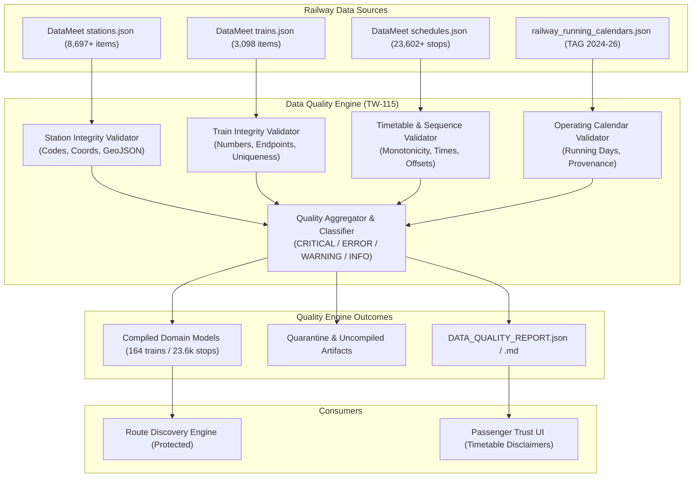

# TW-115 Implementation Plan — Data Quality & Passenger Trust

## 1. Objectives & Scope
Build a comprehensive data-quality validation, quarantine audit, and passenger trust layer around TripWiser's railway dataset:
- **Data Integrity Validation**: Multi-level integrity rules for Stations (geometry, coordinates, code uniqueness, metadata), Trains (numbers, names, endpoint references), Timetable Schedules (sequence monotonicity, arrival/departure chronology, day offset validity, reference integrity), and Journey Continuity.
- **Data Quality Engine**: A modular, deterministic validation service with standardized severities (`CRITICAL`, `ERROR`, `WARNING`, `INFO`), distinct status outcomes (`VALID`, `REJECTED`, `REVIEW_REQUIRED`, `RETAINED_INCOMPLETE`), error codes, and audit traceability.
- **Administrative Quality Reporting & CLI**: Generation of machine-readable JSON (`data_quality_report.json`) and human-readable Markdown (`DATA_QUALITY_REPORT.md`) audits, including data coverage breakdown, common failures, and explicit data freshness statements without fabrication.
- **Route Engine Protection**: Hardened guards ensuring route discovery only consumes verified, monotonically sequenced, calendar-backed timetable records.
- **Passenger Trust & Transparency**: Clear, honest passenger-facing indicators distinguishing published timetable schedules from live operations without exposing technical jargon or cluttering the UI.

---

## 2. Architecture & Data Flow

---

## 3. Implementation Phases

### Phase 1: Data Quality Domain Models & Engine
- File: `backend/app/domain/models/data_quality.py`:
  - `QualitySeverity`: `CRITICAL`, `ERROR`, `WARNING`, `INFO`
  - `QualityStatus`: `VALID`, `REJECTED`, `REVIEW_REQUIRED`, `RETAINED_INCOMPLETE`
  - `ValidationFinding`: `record_type`, `record_id`, `code`, `severity`, `message`, `details`, `source_ref`
  - `ValidationSummary`: totals, counts by severity, category grouping, failure frequencies, and reproducibility metadata.
- File: `backend/app/domain/services/data_quality_engine.py`:
  - `DataQualityEngine`:
    - `validate_stations(stations)`: checks missing/duplicate codes, coordinate bounds (India latitude 6°-38°N, longitude 68°-98°E), missing names/states.
    - `validate_trains(trains, valid_stations)`: checks train number format, duplicate train numbers, valid origin/destination station references, distinct endpoints.
    - `validate_schedules(schedules, valid_stations, valid_trains)`: checks stop sequences ($>0$, strictly increasing, unique sequence numbers per train), valid arrival/departure times, chronological ordering, positive dwell times or non-decreasing times across day offsets, day offset validity ($\ge 0$ and consistent with overnight crossings).
    - `validate_running_calendars(calendars, valid_trains)`: checks running days integers ($0-6$ for Mon-Sun), non-empty operating days, official provenance references.
    - `generate_quality_report(...)`: compiles reproducible metrics and classification counts.

### Phase 2: Route Engine Protection & Hardening
- Audit `backend/app/domain/services/route_engine.py`:
  - Ensure defensive checks reject any train with unverified calendars, empty schedules, non-increasing stop sequences, or negative leg duration.
  - Fail safely without constructing incomplete journeys or corrupt layovers.

### Phase 3: Administrative Audit CLI & Report Generation
- File: `backend/app/cli/audit_data_quality.py`:
  - Administrative CLI tool:
    `python -m app.cli.audit_data_quality --format both --out-dir backend/data/reports`
  - Generates machine-readable `data_quality_report.json` and human-readable `DATA_QUALITY_REPORT.md`.
  - Includes explicit statement on static data freshness without fabricating dates.

### Phase 4: Passenger Trust UI Refinement
- Review and refine passenger-facing copy in:
  - `DataIntegrityBanner.tsx`
  - `TrainScheduleView.tsx`
  - `RouteCard.tsx`
  - `JourneyDetailsModal.tsx`
  - Maintain clean, understandable language: "Scheduled timetable data. Live delay feeds and seat availability deferred."

### Phase 5: Verification & Testing
- Add `backend/tests/unit/domain/test_data_quality_engine.py`.
- Add `backend/tests/unit/domain/test_route_engine_quality_protection.py`.
- Run full backend regression suite (`pytest`).
- Run Next.js frontend production build (`npm run build`).
- Run browser E2E test suite.

